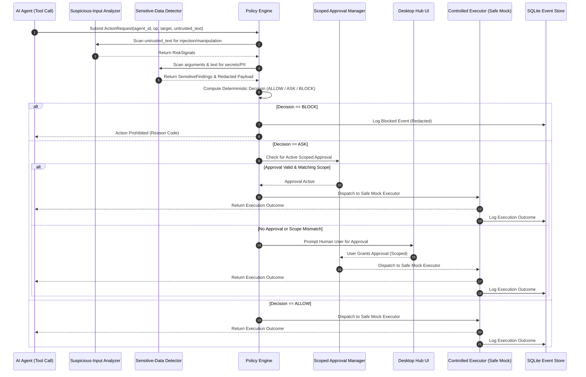
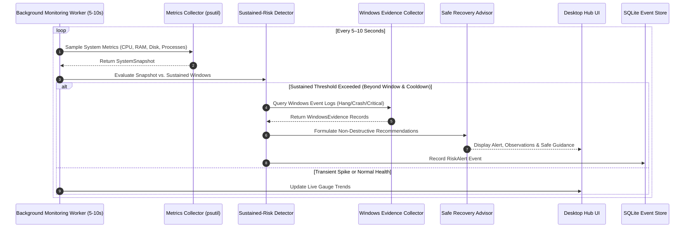

# Authoritative System Architecture Specification

> **V1 Specification Status: FROZEN**  
> This document specifies the technical architecture, subsystem boundaries, data schemas, interaction flows, and boundary rules for SENTRON V1. All implementation code must strictly conform to these architectural specifications.

---

## 1. High-Level Architecture

SENTRON is structured as a **Modular Monolith** desktop application running locally on Windows. It separates user interface, background monitoring, deterministic security policy evaluation, and local persistence into decoupled, testable Python packages under `sentron.*`.

```
+-----------------------------------------------------------------------------------+
|                           Movable Floating Desktop Hub                            |
|                            (PySide6 Desktop UI Layer)                             |
|  - Floating movable desktop icon / widget                                         |
|  - Real-time module health status (never claims active if worker unavailable)     |
|  - AgentGuard Dashboard (latest 5 security events + searchable history)           |
|  - CrashGuard Dashboard (genuine metrics, trends, alerts, recovery guidance)      |
|  - Unified Timeline Search (temporal correlation across modules)                 |
+-----------------------------------------+-----------------------------------------+
                                          |
                      Qt Signals / Thread-Safe Invocations
                                          |
+-----------------------------------------v-----------------------------------------+
|                                    Shared Core                                    |
|  - Event Bus & In-Memory Dispatcher: sentron.core.event_bus                       |
|  - Local SQLite Event Store: sentron.core.storage (Audit logs & telemetry history)|
|  - Core Data Models & Typed Schemas: sentron.core.models                          |
|  - Application Configuration & Thresholds: sentron.core.config                    |
+---------------------+---------------------------------------+---------------------+
                      |                                       |
+---------------------v-------------------+   +---------------v---------------------+
|            AgentGuard Subsystem         |   |         CrashGuard Subsystem        |
|  (AI-Agent Security & Governance)       |   |      (System Health & Recovery)     |
|                                         |   |                                     |
|  A. Suspicious-Input Analyzer           |   |  A. Metrics Collector (psutil)      |
|     - Rule-based prompt injection scan  |   |     - Genuine CPU, RAM, disk, tasks |
|     - Manipulation & override detection |   |     - Explicit unavailable warnings |
|     - Risk signals & evidence emission  |   |                                     |
|                                         |   |  B. Background Monitoring Worker    |
|  B. Sensitive-Data Detector             |   |     - Dedicated background thread   |
|     - Regex/pattern recognition         |   |     - 5-10s configurable cadence    |
|     - Secret redaction in logs/events   |   |     - Bounded ring buffer           |
|     - Explicit pattern limits           |   |     - Severe load backoff           |
|                                         |   |                                     |
|  C. Deterministic Policy Engine         |   |  C. Sustained-Risk Detector         |
|     - Authoritative ALLOW / ASK / BLOCK |   |     - Configurable thresholds       |
|     - Default-deny on high-impact       |   |     - Sustained duration windows    |
|     - Explicit reason codes             |   |     - Alert cooldown logic          |
|                                         |   |     - CPU spike != crash            |
|  D. Scoped Approval Manager             |   |                                     |
|     - Scoped by target, op, recipient   |   |  D. Windows Evidence Collector      |
|     - Expiry & session validation       |   |     - Event Log parser (hang/crash) |
|     - Invalidation on parameter change  |   |     - Driver & update records       |
|                                         |   |     - Graceful permission fallback  |
|  E. Controlled Execution Gatekeeper     |   |                                     |
|     - Strict pre-execution gating       |   |  E. Safe Recovery Advisor           |
|     - Safe mock executor for demo       |   |     - Confirmed observation vs cause|
|     - No arbitrary shell / destructive  |   |     - Actionable user advice        |
|                                         |   |     - NO automatic kill / suspend   |
|  F. Security Audit Logger               |   |                                     |
|     - Minimal redacted audit records    |   +-------------------------------------+
|     - Writes to shared SQLite store     |
+-----------------------------------------+
                      |                                       |
+---------------------v---------------------------------------v---------------------+
|                          Platform Adapters (Windows-First)                        |
|  - sentron.platform.windows.event_log: Windows Event Log query adapters           |
|  - sentron.platform.windows.metrics: Windows-specific counters & process helpers  |
|  - sentron.platform.windows.startup: Optional startup registration               |
+-----------------------------------------------------------------------------------+
```

---

## 2. AgentGuard Subsystem Architecture

AgentGuard is responsible for intercepting proposed AI-agent tool calls and action requests, validating them against deterministic security rules, ensuring human approval when warranted, and safely executing permitted operations.

### A. Suspicious-Input Analyzer (`sentron.agentguard.input_risk`)
- **Responsibility**: Analyzes untrusted text input, prompts, context payloads, and tool arguments for manipulation attempts.
- **Mechanism**: Deterministic rule-based pattern matching:
  - System prompt override markers (e.g., `ignore previous instructions`, `disregard safety rules`, `new system directive`).
  - Known jailbreak signatures and role-play exploits (e.g., `DAN mode`, `developer mode override`).
  - Delimiter and context breakout attempts (e.g., markdown injection, artificial XML/JSON boundary closures).
- **Guarantees & Constraints**:
  - Emits structured `RiskSignal` objects containing finding names, matching evidence snippets, and risk indicator levels.
  - Findings are treated as **signals**, not mathematical proof of malicious intent.
  - **This component must never independently authorize or execute an action.**

### B. Sensitive-Data Detector (`sentron.agentguard.sensitive_data`)
- **Responsibility**: Scans action arguments, destinations, and untrusted payloads for recognizable credentials and personal confidential data.
- **Detection Patterns**:
  - High-entropy API key patterns (OpenAI `sk-...`, GitHub `ghp_...`, AWS Access Keys `AKIA...`, Google Cloud tokens, generic Bearer tokens).
  - Password and private credential assignment expressions.
  - Confidential personal identifiable information (PII) patterns.
- **Redaction Policy**:
  - Automatically redacts identified secret substrings in logs and database event payloads (e.g., replaced with `[REDACTED_API_KEY]`).
  - Raw credentials are never logged or stored in cleartext.
- **Documentation of Limits**: Regular expression and entropy heuristics cannot guarantee detection of all confidential formats or novel secret schemes.

### C. Deterministic Policy Engine (`sentron.agentguard.policy`)
- **Responsibility**: Authoritatively assigns one of three decisions to every structured action request:
  - `ALLOW`: Permitted to execute immediately.
  - `ASK`: Requires explicit human user approval before execution can proceed.
  - `BLOCK`: Prohibited from execution under all circumstances.
- **Structured Action Request Schema (`ActionRequest`)**:
  - `action_id`: Unique identifier (UUID).
  - `agent_id`: Identity/name of the requesting AI agent.
  - `operation`: Proposed action type (e.g., `file_read`, `file_write`, `delete`, `network_fetch`, `send_email`).
  - `target`: Target file path, URL, process, or resource identifier.
  - `data_category`: Classification of target data (`public`, `internal`, `confidential`, `secret`).
  - `destination_or_recipient`: Target recipient or network endpoint (if applicable).
  - `purpose_or_task_context`: Human-readable statement of current agent task.
  - `untrusted_text`: Accompanying untrusted prompt or context text for analysis.
  - `timestamp`: UTC timestamp of request generation.
- **Structured Policy Decision Schema (`PolicyResult`)**:
  - `decision`: Enum (`ALLOW`, `ASK`, `BLOCK`).
  - `reason_code`: Programmatic reason identifier (e.g., `POLICY_BLOCK_CONFIDENTIAL_DELETION`).
  - `explanation`: Clear human-readable justification.
  - `required_approval_scope`: Specific `ApprovalScope` requirements (if decision is `ASK`).
  - `risk_flags`: Combined list of risk flags from input and sensitive-data analyzers.
  - `event_id`: Trace identifier linked to the audit log.
- **Policy Rules & Safe Defaults**:
  - **Default-Deny / Ask**: Unknown, malformed, or underspecified actions must never default to `ALLOW`.
  - **High-Impact Operations**: Operations involving deletion, secret access, or external data transmission must trigger `ASK` or `BLOCK`.
  - **Signal Decoupling**: A low risk score from the Suspicious-Input Analyzer does not grant permission to an action that otherwise requires approval.

### D. Scoped Approval Manager (`sentron.agentguard.approval`)
- **Responsibility**: Manages interactive human approval tokens and verifies that approvals strictly match proposed actions.
- **Approval Scope Properties (`ApprovalScope`)**:
  - `agent_id`: Restricted to the specific agent requesting approval.
  - `operation`: Restricted to the approved operation.
  - `target`: Restricted to the exact canonical resource target.
  - `destination_or_recipient`: Restricted to approved recipient or network host.
  - `purpose_or_task`: Bound to the stated task context.
  - `expires_at`: Absolute expiration timestamp.
  - `session_id`: Bound to the active user session.
- **Scope Invalidation**:
  - Approvals are strictly non-transferable.
  - If any parameter of an action (target path, recipient, operation) is modified after approval is granted, the prior approval is immediately invalidated and a fresh approval is required.
  - No blanket or permanent approvals are permitted in V1.

### E. Controlled Executor (`sentron.agentguard.executor`)
- **Responsibility**: Serves as the sole authorized execution gatekeeper for agent actions.
- **Execution Workflow**:
  1. Receives proposed action.
  2. Submits action to Policy Engine for evaluation.
  3. If decision is `BLOCK`: Terminates immediately; records rejection; **action never touches the executor**.
  4. If decision is `ASK`: Checks Scoped Approval Manager for a valid, matching, unexpired approval. If missing, pauses action, notifies user via UI hub, and waits for approval. If denied, marks rejected.
  5. If decision is `ALLOW` (or approved `ASK`): Dispatches execution through the execution adapter.
  6. Captures execution outcome (`ExecutionOutcome`) and writes sanitized record to the audit store.
- **Safe Mock Executor for V1 Demo**:
  - V1 uses a safe mock executor that simulates tool behavior with synthetic fixtures.
  - **Strictly prohibited in V1 Demo**: Arbitrary shell execution (`cmd.exe`, `powershell.exe`), destructive file deletion, and unrestricted external network transmission.

### F. Security Audit History (`sentron.agentguard.storage`)
- Records attempted actions, input risk signals, sensitive data findings (redacted), policy decisions, approval responses, and execution results into the local SQLite database.
- AgentGuard dashboard displays the **latest five security events** in real time and provides a search interface for querying historical records.
- **Security Boundary**: SENTRON protects only actions that pass through its supported integration and controlled executor. Unintegrated third-party agents operating outside this path cannot be governed.

---

## 3. CrashGuard Subsystem Architecture

CrashGuard provides real-time operating system health monitoring, detects sustained hardware pressure, gathers Windows diagnostic records, and recommends non-destructive recovery steps.

### A. Metrics Collector (`sentron.crashguard.metrics`)
- **Responsibility**: Samples authentic hardware and process metrics from the Windows operating system.
- **Telemetry Collected via `psutil`**:
  - **CPU**: Total system CPU utilization percentage and per-core distribution.
  - **Memory**: Total RAM, available RAM bytes, memory usage percentage, and swap usage.
  - **Disk**: Free disk space in bytes, disk utilization percentage, and I/O activity rates.
  - **Process Telemetry**: Top N processes ranked by CPU and memory consumption (PID, process name, CPU percent, memory RSS bytes).
  - **Process Trends**: Rolling delta of process resource consumption over recent samples.
- **Integrity Guarantee**:
  - **Simulated data must never be presented as real system telemetry.**
  - If a metric cannot be read (e.g., due to OS permissions or missing counters), it is explicitly recorded as `None` in `unavailable_metrics`, and an honest warning is surfaced in the UI.

### B. Background Monitoring Worker (`sentron.crashguard.worker`)
- **Responsibility**: Periodically triggers metrics collection without blocking the user interface.
- **Implementation & Concurrency**:
  - Executes on a dedicated background thread (or PySide6 `QThread`).
  - Sampling interval is configurable (default: **5 to 10 seconds**).
  - Collected snapshots are appended to a **bounded circular buffer** (fixed size, e.g., 60 samples representing the last 5–10 minutes) to strictly bound memory consumption.
  - Emits Qt signals / event notifications upon snapshot capture.
- **Lifecycle & Resource Backoff**:
  - Clean worker shutdown lifecycle triggered on application exit.
  - **Severe Load Backoff**: If system CPU exceeds 95% or available memory drops below 5%, the worker automatically suppresses optional secondary diagnostics (such as deep process tree analysis and heavy event log queries) to avoid exacerbating system strain.

### C. Sustained-Risk Detector (`sentron.crashguard.risk`)
- **Responsibility**: Analyzes telemetry history to detect persistent, potentially hazardous resource conditions while filtering out benign transient spikes.
- **Detection Criteria**:
  - **Configurable Thresholds**: Warning and Critical thresholds for CPU %, Memory %, and Disk Free GB.
  - **Duration Windows**: A condition must persist across a specified time window (e.g., CPU > 90% sustained for 30+ seconds) before triggering an alert.
  - **Alert Cooldowns**: Once an alert is emitted for a sustained condition, a cooldown period (e.g., 120 seconds) prevents repetitive alert spam for the same unresolved issue.
- **Diagnostic Honesty**:
  - High CPU utilization alone is recognized as a transient condition or heavy workload, **not definitive proof of an impending crash**.

### D. Windows Evidence Collector (`sentron.crashguard.evidence`)
- **Responsibility**: Queries native Windows diagnostic subsystems for concrete error evidence when available and permitted.
- **Evidence Sources (Windows Event Logs)**:
  - `Application Error` (Event ID 1000) — application crash reports.
  - `Application Hang` (Event ID 1002) — frozen or unresponsive window events.
  - `Kernel-Power` / `EventLog` (Event ID 6008) — previous unexpected system shutdowns.
  - Critical system errors and recent driver update records.
- **Graceful Degradation**:
  - Access to Windows Event Logs requires appropriate OS permissions. If unprivileged, the collector gracefully records the permission restriction, continues operating normal `psutil` metrics, and reports missing log access in the dashboard without failing.

### E. Diagnostics & Safe Recovery Advisor (`sentron.crashguard.recovery`)
- **Responsibility**: Formulates user-facing recovery guidance based on observed metrics and event evidence.
- **Presentation Standards**:
  - **Strictly separates confirmed observations from inferred causes** (e.g., "Confirmed: RAM utilization is 94% with Process X consuming 4.2 GB" vs. "Suspected: Process X may have an unbounded memory leak").
  - Formulates actionable, non-destructive recommendations:
    - Advises user to save unsaved documents in active applications.
    - Suggests closing specific non-essential high-memory applications.
    - Recommends investigating specific runaway processes.
- **Safety Policy**:
  - **CrashGuard NEVER automatically kills, suspends, or pauses processes in V1.**
  - Never claims guaranteed crash prevention or absolute prediction capability.

---

## 4. Desktop UI & Unified Event History

The user interface is built with **PySide6** and revolves around a **movable floating desktop hub**.

```
+--------------------------------------------------------------+
| [O] SENTRON HUB                          [Status: Active]    |
| AgentGuard: 0 Pending | CrashGuard: Normal (CPU 18%, RAM 42%)|
+--------------------------------------------------------------+
|  [ AgentGuard View ]  |  [ CrashGuard View ]  |  [ Timeline ] |
+--------------------------------------------------------------+
```

### Desktop UI Specifications
1. **Floating Movable Hub**:
   - A compact, always-on-top desktop icon or small docked bar.
   - Draggable across monitors and positions.
   - Displays live operational status of both subsystems.
   - **Accurate Availability Guarantee**: Never displays a subsystem as "Active" or "Protecting" if the background worker is stopped, permissions are missing, or required integrations are disconnected.
2. **AgentGuard Dashboard**:
   - Displays pending approval requests awaiting human decision.
   - Displays a feed of the **latest five security and sensitive-data events**.
   - Provides historical search and filter capabilities across past audit events.
3. **CrashGuard Dashboard**:
   - Displays genuine live CPU, RAM, and disk gauges and rolling trend charts.
   - Surfaces active sustained-risk alerts with duration indicators.
   - Displays collected Windows event evidence.
   - Displays prioritized, safe recovery recommendations.
4. **Unified Event History & Timeline**:
   - Stores all security audit events, health snapshots, risk alerts, and recovery recommendations in a shared SQLite database table (`events`).
   - Enables searching and filtering by timestamp, subsystem, severity, and event type.
   - **Causality Disclaimer**: Explicitly informs the user that temporal correlation between an agent action and a system resource spike provides investigative context, not conclusive proof of causality.

---

## 5. Core Data Schemas

All subsystems communicate through strictly typed Python data models defined in `sentron.core.models`:

```python
from dataclasses import dataclass, field
from enum import Enum
from typing import List, Optional, Dict, Any

class PolicyDecision(str, Enum):
    ALLOW = "ALLOW"
    ASK = "ASK"
    BLOCK = "BLOCK"

class DataCategory(str, Enum):
    PUBLIC = "public"
    INTERNAL = "internal"
    CONFIDENTIAL = "confidential"
    SECRET = "secret"

@dataclass(frozen=True)
class RiskSignal:
    finding_type: str
    evidence_snippet: str
    risk_level: str  # low, medium, high, critical
    details: str

@dataclass(frozen=True)
class ActionRequest:
    action_id: str
    agent_id: str
    operation: str
    target: str
    data_category: DataCategory = DataCategory.INTERNAL
    destination_or_recipient: Optional[str] = None
    purpose_or_task_context: str = ""
    untrusted_text: Optional[str] = None
    timestamp: float = 0.0

@dataclass(frozen=True)
class ApprovalScope:
    approval_id: str
    agent_id: str
    operation: str
    target: str
    destination_or_recipient: Optional[str]
    purpose_or_task: str
    granted_at: float
    expires_at: float
    session_id: str

@dataclass(frozen=True)
class PolicyResult:
    decision: PolicyDecision
    reason_code: str
    explanation: str
    required_approval_scope: Optional[ApprovalScope] = None
    risk_flags: List[str] = field(default_factory=list)
    event_id: str = ""
    timestamp: float = 0.0

@dataclass(frozen=True)
class ExecutionOutcome:
    action_id: str
    executed: bool
    status: str  # success, blocked, denied, failed
    result_summary: str
    error_message: Optional[str] = None
    timestamp: float = 0.0

@dataclass(frozen=True)
class ProcessSummary:
    pid: int
    name: str
    cpu_percent: float
    memory_mb: float

@dataclass(frozen=True)
class SystemSnapshot:
    timestamp: float
    cpu_percent: float
    memory_percent: float
    memory_available_bytes: int
    disk_free_bytes: int
    disk_busy_percent: Optional[float]
    top_processes: List[ProcessSummary] = field(default_factory=list)
    unavailable_metrics: List[str] = field(default_factory=list)

@dataclass(frozen=True)
class RiskAlert:
    alert_id: str
    metric_name: str
    severity: str  # warning, critical
    observed_value: float
    threshold_value: float
    duration_seconds: float
    cooldown_until: float
    timestamp: float

@dataclass(frozen=True)
class WindowsEvidence:
    event_id: int
    log_channel: str
    source: str
    event_time: str
    description: str
    raw_data: Optional[Dict[str, Any]] = None

@dataclass(frozen=True)
class RecoveryRecommendation:
    recommendation_id: str
    severity: str
    title: str
    suggested_action: str
    confirmed_observations: List[str]
    suspected_causes: List[str]
    is_automated: bool = False  # Always False in V1

@dataclass(frozen=True)
class UnifiedEvent:
    event_id: str
    timestamp: float
    subsystem: str  # AgentGuard, CrashGuard, Core
    event_type: str
    severity: str  # info, warning, critical
    summary: str
    payload_json: str
    redacted: bool = False
```

---

## 6. SQLite Database Schema

The local event store is managed by `sentron.core.storage` using SQLite:

```sql
CREATE TABLE IF NOT EXISTS events (
    event_id TEXT PRIMARY KEY,
    timestamp REAL NOT NULL,
    subsystem TEXT NOT NULL,         -- 'AgentGuard' | 'CrashGuard' | 'Core'
    event_type TEXT NOT NULL,        -- 'POLICY_EVAL' | 'EXECUTION' | 'SYSTEM_ALERT' | etc.
    severity TEXT NOT NULL,          -- 'info' | 'warning' | 'critical'
    summary TEXT NOT NULL,
    payload_json TEXT NOT NULL,      -- Redacted JSON serialization of event data
    redacted INTEGER DEFAULT 0       -- 1 if sensitive data was sanitized
);

CREATE INDEX IF NOT EXISTS idx_events_timestamp ON events(timestamp);
CREATE INDEX IF NOT EXISTS idx_events_subsystem ON events(subsystem);
CREATE INDEX IF NOT EXISTS idx_events_event_type ON events(event_type);

CREATE TABLE IF NOT EXISTS approvals (
    approval_id TEXT PRIMARY KEY,
    agent_id TEXT NOT NULL,
    operation TEXT NOT NULL,
    target TEXT NOT NULL,
    destination TEXT,
    purpose TEXT,
    granted_at REAL NOT NULL,
    expires_at REAL NOT NULL,
    session_id TEXT NOT NULL
);
```

---

## 7. Interaction Workflows

### AgentGuard Action Evaluation & Execution Flow


### CrashGuard Telemetry, Sustained Risk, and Recovery Flow


---

## 8. Operating System Integration & Platform Isolation

All platform-specific calls are quarantined in `sentron.platform.windows`:
- **Windows Event Log Access**: Implemented using Windows interfaces (`win32evtlog`, `wevtutil`, or PowerShell interop). When running with standard user privileges where some channels require elevation, the adapter catches access-denied errors, flags them in `unavailable_metrics`, and never terminates the application.
- **Cross-Platform Compatibility**: While SENTRON V1 targets Windows workstations, core business logic, policies, and unit tests are written to run on any platform (Linux/macOS) by stubbing Windows-specific collectors.
